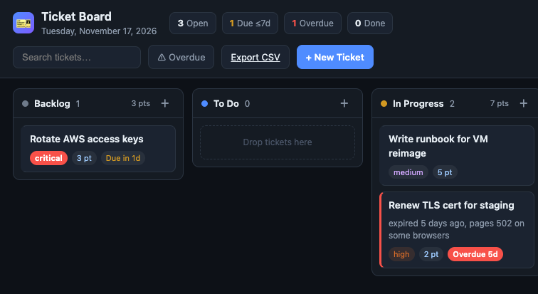

# Ticket Board

A lightweight, self-hosted ticket & kanban tracker. One Docker container, one
SQLite file, zero build steps. Track what's on your plate with due dates,
effort estimates, and a scrum-style board — no account, no telemetry, no
database server.



## Features

- **Scrum board** — five columns (Backlog → To Do → In Progress → Review → Done) with drag-and-drop between them
- **Due dates** — cards show `Overdue Nd` (red), `Due today` (amber), or `Due in Nd` chips; overdue cards get a red edge; header stats track Open / Due ≤7d / Overdue / Done
- **Effort estimates** — story points (1, 2, 3, 5, 8, 13) per card, with point totals per column so you can size a sprint at a glance
- **Priorities** — Low / Medium / High / Critical badges
- **Search & filters** — live text search across titles and descriptions, plus a one-click "overdue only" view
- **CSV export** — one click to dump the whole board for a spreadsheet or backup
- **Fast & private** — server-rendered single page, vanilla JS, no external CDNs, no fonts to fetch; runs fine on a Raspberry Pi
- **Durable** — all data lives in a single SQLite file on a Docker volume; survives restarts, rebuilds, and redeploys
- **REST API** — script it, automate it, or build on top of it
- **Keyboard** — `N` = new ticket, `Esc` = close dialog

## Quickstart

```bash
git clone <repo-url> ticket-board
cd ticket-board
docker compose up -d --build
```

Open `http://localhost:8080`. That's the whole setup.

## Deploy to a VM

```bash
# on your machine — copy the folder over (or git clone directly on the VM)
scp -r ticket-board <user>@<vm-ip>:~/ticket-board

# on the VM (Docker installed)
cd ~/ticket-board
docker compose up -d --build
```

Open `http://<vm-ip>:8080`. All data lives in the `tickets-data` Docker volume
(SQLite at `/data/tickets.db` inside the container), so it survives container
rebuilds and redeploys.

### Useful ops

```bash
docker compose logs -f tickets                              # live logs
docker compose cp tickets:/data/tickets.db ./tickets-backup-$(date +%F).db   # backup
docker compose cp tickets-backup-2026-11-17.db tickets:/data/tickets.db && docker compose restart tickets  # restore
git pull && docker compose up -d --build                    # update
docker compose down -v                                      # remove (DELETES DATA)
```

### Security notes

On a LAN, port 8080 is fine as-is. If you expose it beyond the LAN, put it
behind a reverse proxy with TLS (Caddy/nginx) and ideally auth, or expose it
only to a Tailscale/VPN address. There is no built-in login — treat the port as
a trust boundary.

```bash
# example: restrict the port to your home/office IP
sudo ufw allow from <your-ip> to any port 8080 proto tcp
```

## API

| Method | Path | Notes |
|---|---|---|
| GET | `/api/tickets?status=todo` | list (optional column filter) |
| POST | `/api/tickets` | create — `{title, description, status, points, priority, due_date}` |
| PATCH | `/api/tickets/<id>` | partial update, e.g. `{status: "in_progress"}` |
| DELETE | `/api/tickets/<id>` | delete |
| GET | `/api/tickets/export.csv` | CSV dump |
| GET | `/api/health` | health check |

Example:

```bash
curl -X POST http://localhost:8080/api/tickets \
  -H 'Content-Type: application/json' \
  -d '{"title":"Renew TLS cert","status":"todo","points":2,"priority":"high","due_date":"2026-12-01"}'
```

Statuses: `backlog`, `todo`, `in_progress`, `review`, `done`.
Priorities: `low`, `medium`, `high`, `critical`.

## Development

No build step. Install Flask + waitress and run:

```bash
pip install flask waitress
TICKETS_DB=~/dev-tickets.db python server.py
```

- `app.py` — the whole backend (Flask + stdlib `sqlite3`, no ORM)
- `templates/index.html` — the whole frontend (inline CSS/JS, no framework)
- `server.py` — waitress entrypoint (the container CMD)
- DB path comes from the `TICKETS_DB` env var (defaults to `/data/tickets.db`
  in the container, project dir locally)

## Tech stack

Python 3.12 · Flask · waitress · SQLite · vanilla JS — that's it.

## License

MIT — use it, fork it, self-host it.
